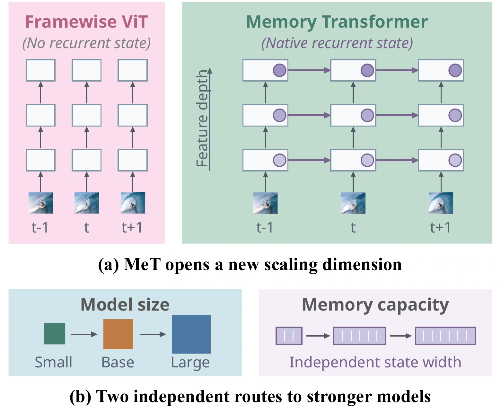
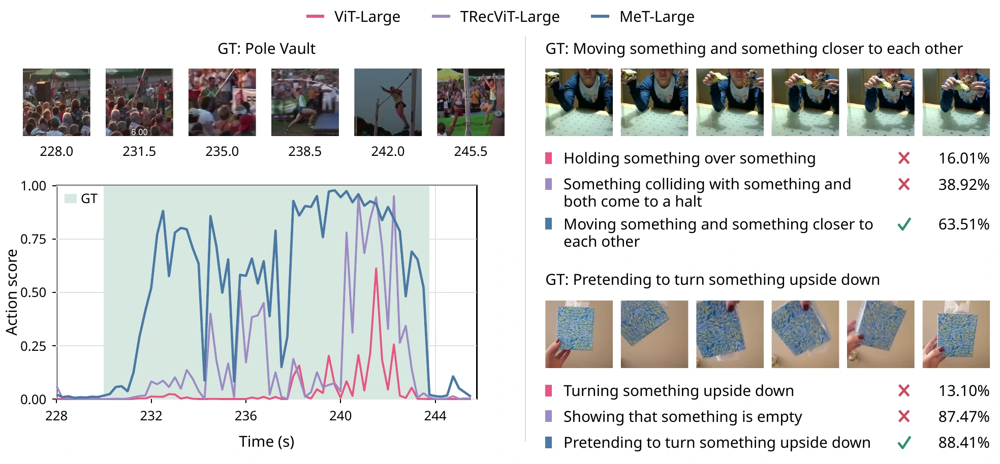
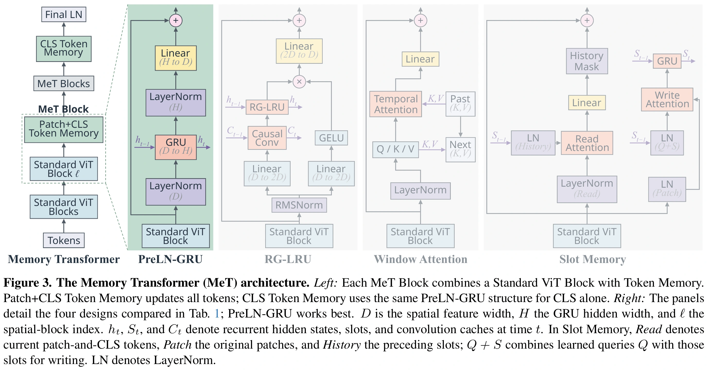
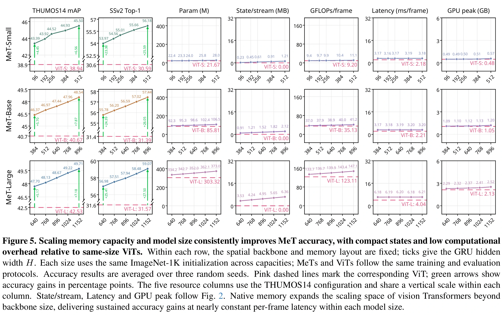
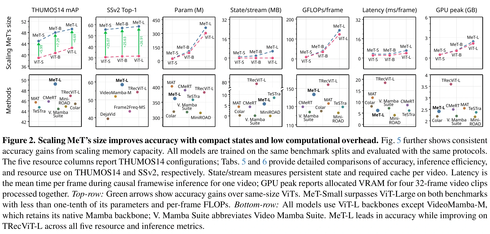
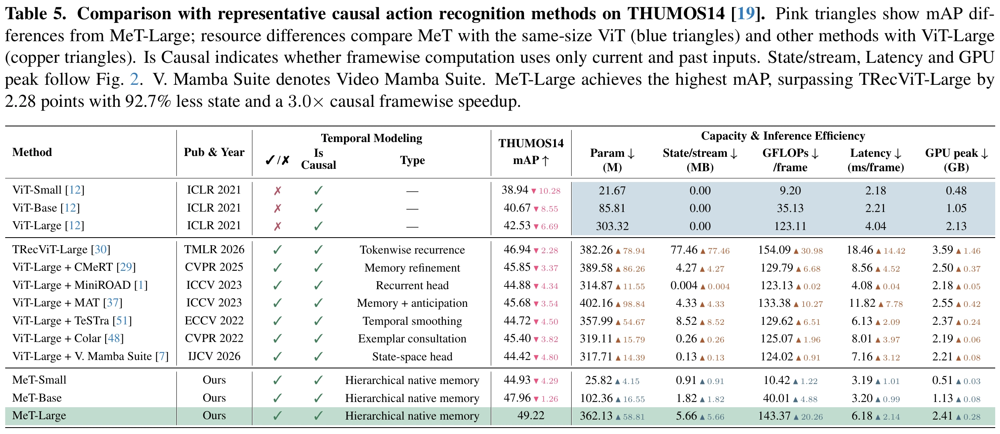
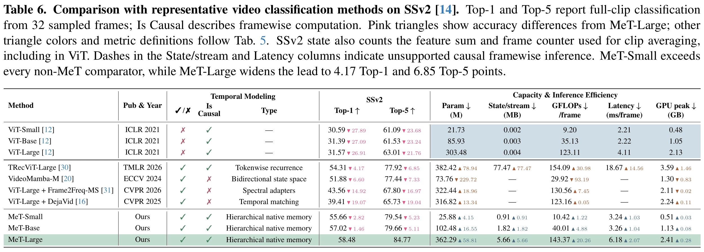

<h1 align="center">Native Scalable Memory Models with Transformers</h1>

<p align="center"><em> MeT makes native visual memory an independently scalable architectural resource, establishing two scaling trends with compact states and low computational overhead</em></p>

<p align="center">
  <a href="https://ziyangxu.top/">Ziyang&nbsp;Xu</a><sup>1</sup>,
  Lucia&nbsp;Cascone<sup>2</sup>,
  Aniello&nbsp;Castiglione<sup>2</sup>,
  Michele&nbsp;Nappi<sup>2</sup>,
  Wenyu&nbsp;Liu<sup>1</sup>,
  Xinggang&nbsp;Wang<sup>1</sup><a href="mailto:xgwang@hust.edu.cn" aria-label="Email Xinggang Wang, corresponding author">✉</a>
</p>

<p align="center">
  <sup>1</sup> Huazhong University of Science and Technology &nbsp;·&nbsp;
  <sup>2</sup> University of Salerno<br>
  ✉: Corresponding Author
</p>

<p align="center">
  <strong><a href="https://hustvl.github.io/MeT/">Project Page</a></strong>
</p>

<p align="center">
  <a href="assets/met-overview.webp"></a>
</p>

<p align="center">
  <a href="assets/met-qualitative.webp"></a>
</p>

## Highlights

- **Native visual memory as an independently scalable architectural resource.** Memory Transformer (MeT) interleaves ViT blocks with recurrent stages that carry token histories across frames and feed them back into spatial computation through residual readouts. The recurrent width sets memory capacity independently of the backbone's width and depth. The retained state stays bounded as the input sequence grows.

  <p align="center">
    <a href="assets/met-architecture.webp"></a>
  </p>

- **Two complementary scaling trends.** Across **three model sizes and 15 memory capacity configurations**, wider recurrent states consistently improve accuracy on THUMOS14 and SSv2 at fixed backbones and memory layouts. Larger MeT models deliver further gains, including at matched memory widths.

  <p align="center">
    <a href="assets/met-memory-scaling.webp"></a>
  </p>

- **Compact states and low computational overhead.** Within each model size, widening memory changes THUMOS14 latency by at most **0.03 ms per frame**. MeT-Small surpasses ViT-Large on both benchmarks with **less than one-tenth of its parameters and per-frame FLOPs**. On THUMOS14, MeT-Large retains **92.7% less persistent state** and runs causal framewise inference **about 3.0× as fast** as TRecViT-Large.

  <p align="center">
    <a href="assets/met-size-comparison.webp"></a>
  </p>

- **Design studies and benchmark validation.** We characterize the memory mechanisms, token inputs, insertion depths, and stage layouts that support scaling. With the same spatial backbone and ImageNet-1K initialization, MeT-Large outperforms ViT-Large by **6.69 mAP** on THUMOS14 and **26.91 Top-1 accuracy** on SSv2.

  <p align="center">
    <a href="assets/met-thumos14-comparison.webp"></a>
  </p>

  <p align="center">
    <a href="assets/met-ssv2-comparison.webp"></a>
  </p>

<!--
## News

- **`Project page release date`**: We’ve launched the [MeT project page](https://hustvl.github.io/MeT/). Take a look at the interactive scaling charts, detailed results, and visual showcases. Stay tuned for more updates.
- **`Paper release date`**: We’ve released the first public version of the MeT paper.
-->

## Todo

- [ ] Release a simple PyTorch implementation of MeT.
- [ ] Release weights for all MeT model sizes.
- [ ] Release the MeT training scripts.
- [ ] Release the MeT inference and evaluation scripts.

Code and model weights will be released upon acceptance.

<!--
## Citation

```bibtex
@misc{xu2026met,
  title  = {Native Scalable Memory Models with Transformers},
  author = {Xu, Ziyang and Cascone, Lucia and Castiglione, Aniello
            and Nappi, Michele and Liu, Wenyu and Wang, Xinggang},
  year   = {2026},
  url    = {https://hustvl.github.io/MeT/}
}
```
-->
